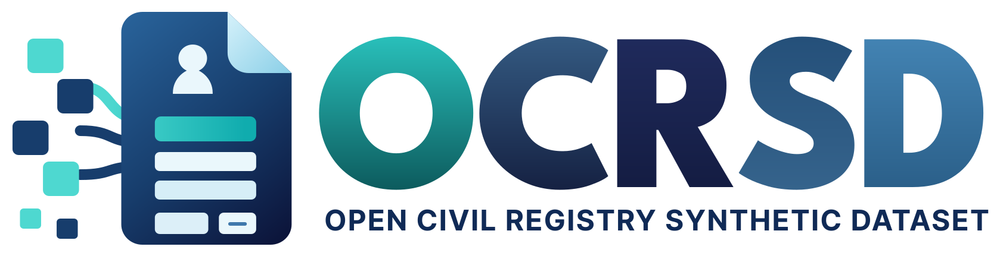
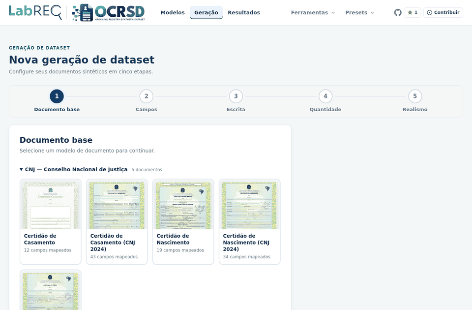
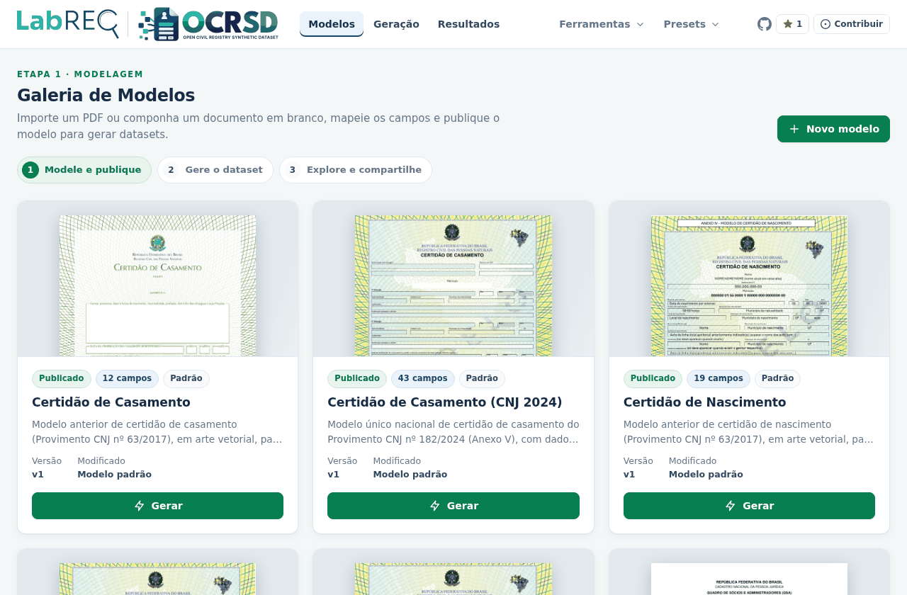
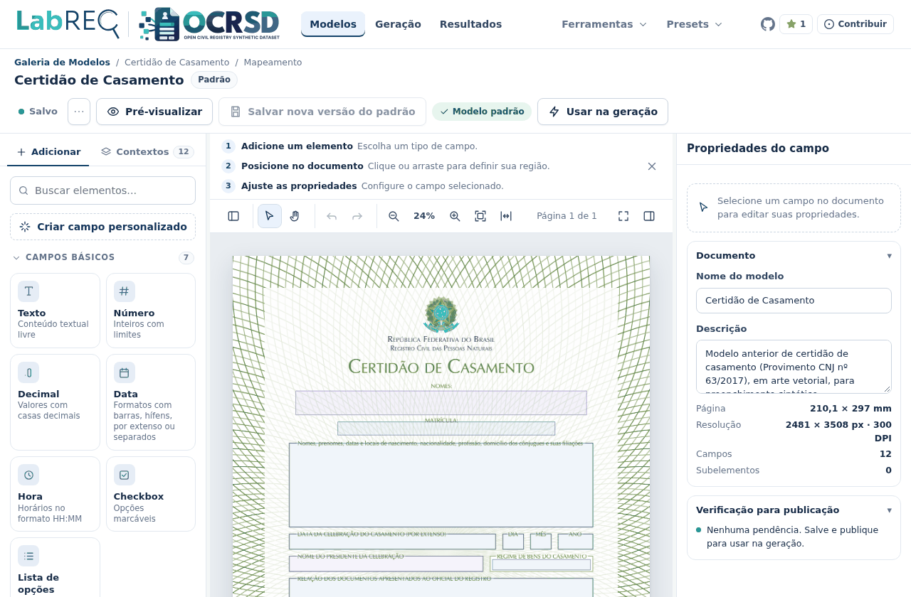
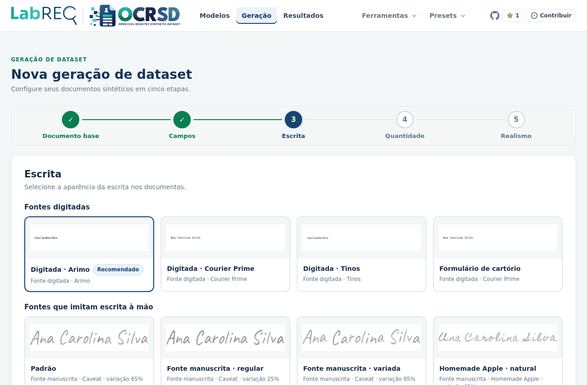
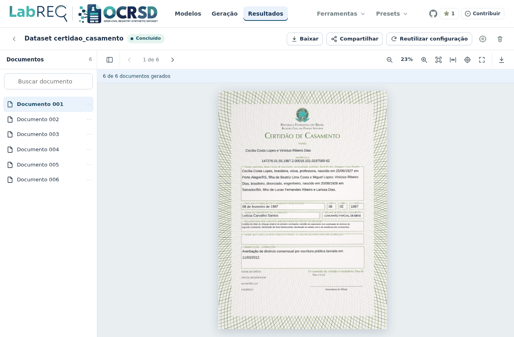
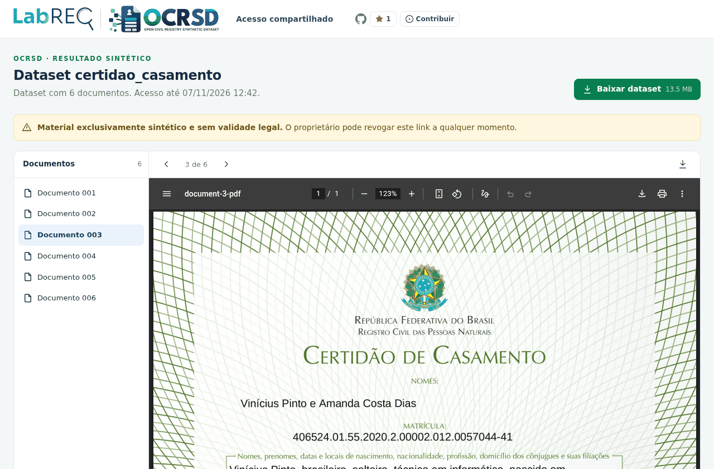

<p align="center"></p>

<p align="center">
  <a href="LICENSE"></a>
  <a href="https://github.com/siqueiratf/ocrsd"></a>
  <a href="https://ocrsd.onrcpn.org.br"></a>
</p>

O OCRSD gera documentos sintéticos do registro civil brasileiro (certidões de
nascimento, casamento e óbito, DNV, DO, procurações e documentos de CNPJ e
DREI) com ground truth: um JSON com o valor e a posição esperados de cada
campo, para treinar e avaliar OCR. A geração combina estilos de escrita à mão
(fontes que imitam caligrafia e síntese neural de manuscrito) e fontes
impressas, além de efeitos de digitalização. Acesse em
[https://ocrsd.onrcpn.org.br](https://ocrsd.onrcpn.org.br).



## Funcionalidades

- Galeria de modelos com templates oficiais dos documentos suportados.
- Editor de campos sobre o PDF, com caixas, zoom e validações.
- Geração guiada em etapas: documento, campos, escrita, quantidade e realismo.
- Estilos de escrita em três categorias, com fonte recomendada por documento.
- Efeitos de digitalização para aproximar o resultado de um documento escaneado.
- Resultados com visualizador e download em ZIP com PDFs e JSON de ground truth.
- Links de compartilhamento revogáveis para os resultados.
- Geração assistida por IA (opcional), que propõe registros coerentes entre os campos.

## Como usar

1. Escolha o documento na **Galeria de Modelos**.
2. Selecione os campos que devem ser gerados.
3. Escolha o estilo de escrita; o estilo recomendado para o documento aparece
   marcado como "Recomendado".
4. Defina a quantidade de documentos.
5. Escolha o nível de realismo (efeitos de digitalização).
6. Gere, acompanhe o progresso e baixe o ZIP, ou compartilhe um link do
   resultado.

<table>
<tr>
<td width="50%"></td>
<td width="50%"></td>
</tr>
<tr>
<td align="center">Galeria de Modelos</td>
<td align="center">Editor de campos</td>
</tr>
</table>

<table>
<tr>
<td width="50%"></td>
<td width="50%"></td>
</tr>
<tr>
<td align="center">Etapa Escrita</td>
<td align="center">Resultados</td>
</tr>
</table>

<p align="center"></p>
<p align="center"><em>Link compartilhado</em></p>

## O que o dataset contém

O ZIP baixado traz, para cada documento gerado: um PDF, um JSON de ground
truth com o valor e a posição esperados de cada campo, e um manifesto
`dataset.json` com o resumo do lote.

## Executar no seu computador

Com Docker Engine e Docker Compose instalados:

```bash
cp deploy/.env.development.example deploy/.env.development
docker compose --env-file deploy/.env.development up -d --build
docker compose --env-file deploy/.env.development ps
curl --fail http://127.0.0.1:8080/api/v1/health
```

Abra **http://127.0.0.1:8080**. Para desenvolver sem Docker, usar a CLI e a
interface desktop, veja [docs/development.md](docs/development.md) e
[docs/cli.md](docs/cli.md).

## Contribuir

Encontrou um problema ou tem uma sugestão? Abra uma issue em
[github.com/siqueiratf/ocrsd/issues](https://github.com/siqueiratf/ocrsd/issues).
Para detalhes de arquitetura, ambiente de desenvolvimento e operação, veja
[docs/development.md](docs/development.md).

## How to cite

If you use OCRSD in academic work, please cite the software. The
[`CITATION.cff`](CITATION.cff) file holds the citation metadata, and GitHub
shows it in the "Cite this repository" menu.

> Siqueira, T. F. de. *OCRSD: Open Civil Registry Synthetic Dataset* (version 1.2.0) [Computer software]. Universidade Federal de Santa Catarina, 2026. https://github.com/siqueiratf/ocrsd

```bibtex
@software{siqueira_ocrsd_2026,
  author    = {Siqueira, Tiago Faustino de},
  title     = {{OCRSD: Open Civil Registry Synthetic Dataset}},
  year      = {2026},
  version   = {1.2.0},
  publisher = {Universidade Federal de Santa Catarina},
  url       = {https://github.com/siqueiratf/ocrsd}
}
```

Each release on GitHub also gets a DOI on Zenodo. Cite the DOI of the version
that you used. To cite OCRSD in general, use the concept DOI, which always
points to the latest version.

## License

The OCRSD source code is available under the [MIT License](LICENSE). The fonts
in `assets/fonts` keep their own licenses, which are in `assets/fonts/LICENSES`.
